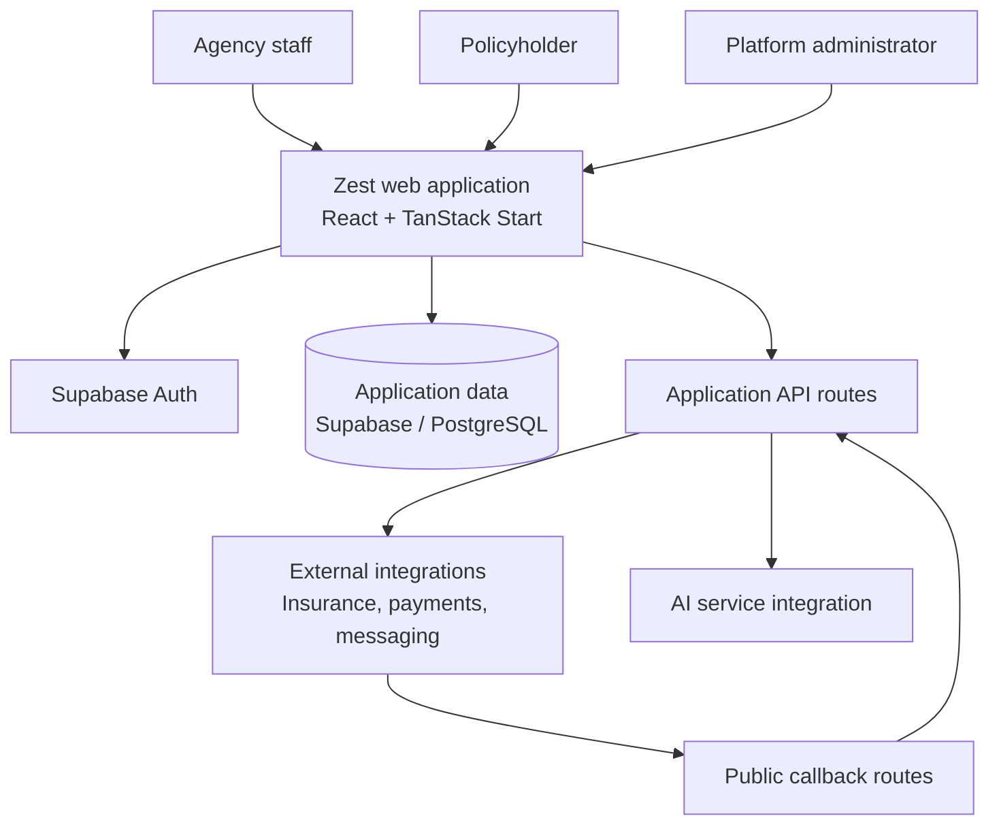

<div align="center">

# Zest Insurance Agency
### Insurance operations, connected.

**A unified workspace for insurance agencies and their customers**

[Explore Features](#platform-capabilities) · [Architecture](#architecture) · [Documentation](#documentation) · [Getting Started](#getting-started)


</div>

---

## Overview

**Zest Insurance Agency** is a web-based insurance management application bringing agency operations and customer self-service into a common platform. Its source includes workspaces for client relationships, quotations, policy records, claims, invoices, renewals and reporting, alongside dedicated customer and platform-administration experiences.

The system is built with **React, TypeScript, TanStack Start and Supabase**. Its routing and authentication code also show an agency-membership model that can support multiple organisations, subject to verification of database-level isolation.

> **Engineering status:** This README describes functionality evidenced by the source tree. **A screen, route or integration endpoint is not proof of a production-ready workflow.** Deployment, end-to-end operation, regulatory suitability and security controls must be validated before commercial use.

## Contents

- [Platform capabilities](#platform-capabilities)
- [Who uses Zest](#who-uses-zest)
- [Architecture](#architecture)
- [Integrations and automation](#integrations-and-automation)
- [Technology stack](#technology-stack)
- [Getting started](#getting-started)
- [Security and data protection](#security-and-data-protection)
- [Documentation](#documentation)
- [Engineering priorities](#engineering-priorities)
- [Contributing](#contributing)

## Platform capabilities

| Area | Purpose | Evidence |
|---|---|---|
| **Agency dashboard** | Central workspace for insurance operations | Route present |
| **Client management** | Manage client records and related workflows | Routes present |
| **Quotations** | Dedicated insurance quotation workspace | Route present |
| **Policies** | Browse and manage policy records | List/detail routes present |
| **Claims** | Dedicated claims management workspace | Route present |
| **Invoicing** | Billing and invoice record views | List/detail routes present |
| **Renewals** | Renewal tracking and related processes | Route present |
| **Reports** | Operational reporting | Route present |
| **Geographic intelligence** | Location-oriented analysis workspace | Route present |
| **AI assistant** | Assistant interface and chat endpoint | Routes present |
| **Customer portal** | Policies, claims, invoices, documents, vehicles and profile | Routes present |
| **Administration** | Agency settings, staff, insurers, branches, security and audit | Routes present |

These are **source-confirmed application areas**, not completed functional acceptance tests. See [feature inventory](docs/FEATURES.md) for the evidence level of each area.

## Who uses Zest

The application separates experiences by user role and agency relationship:

| User group | Intended experience |
|---|---|
| **Agency staff** | Agency operations and assigned business records |
| **Agency administrators** | Agency configuration, users, branches and operational controls |
| **Policyholders** | Self-service customer portal |
| **Platform administrators** | Cross-agency platform management |

The sign-in implementation checks `user_roles`, `tenant_members` and, for some accounts, the linked `clients` record to select a destination. **Navigation logic is not a security boundary**; each database query and server endpoint must independently enforce permissions.

## Architecture

The application uses TanStack Start for application/server routing, React for the user interface, Supabase for authentication and data integration, and dedicated routes for provider callbacks.



*Logical architecture based on inspected source; this is not a verified production infrastructure diagram.*

The code includes distinct agency, customer and platform route groups. It also clears tenant-specific branding caches on relevant authentication changes. The completeness of tenant isolation, RLS and privileged access enforcement is **not yet verified**.

Read the [architecture guide](docs/ARCHITECTURE.md), [database review](docs/DATABASE.md) and [system diagram](docs/diagrams/system-architecture.md).

## Integrations and automation

The repository contains entry points for:

| Capability | Source evidence | Verification needed |
|---|---|---|
| **Supabase** | Auth calls and project configuration | Database permissions, environments and RLS |
| **WhatsApp** | Administration views and webhook route | Provider connectivity, authentication and delivery |
| **IPEN / M-Pesa** | Administration and callback routes | Transaction reconciliation and replay protection |
| **DMVIC** | Administration route | Actual provider workflow and access |
| **Email** | Transactional, preview, webhook and queue routes | Delivery, retries and suppression handling |
| **Renewal automation** | Reminder hook and automation tick routes | Scheduling, deduplication and outcomes |
| **AI assistant** | Chat API and assistant route | Authorisation, privacy and safe data access |

**Integration status:** The source establishes that these routes exist; it does **not** establish that live provider connections, payments or notifications work end to end. See [integration guide](docs/INTEGRATIONS.md).

## Technology stack

| Layer | Technologies observed |
|---|---|
| Frontend | React 19, TypeScript, Tailwind CSS 4, Radix UI |
| Full-stack routing | TanStack Start, TanStack Router |
| Server-state management | TanStack Query |
| Build tooling | Vite 7 |
| Authentication/data integration | Supabase client, PostgreSQL tooling |
| Data validation/forms | Zod, React Hook Form |
| AI-related dependencies | AI SDK packages |
| Visualisation/document tooling | Recharts, MapLibre GL, jsPDF, XLSX |

Versions and installed packages are defined in [`package.json`](package.json). A dependency's presence does not imply a completed product feature.

## Getting started

### Prerequisites

- Node.js version compatible with the project's installed dependencies.
- The package manager indicated by the repository lockfile.
- An authorised, separately configured development backend.

### Local development

```bash
git clone https://github.com/karisajoshua/pixel-perfect-clone-94206-250aa43a.git
cd pixel-perfect-clone-94206-250aa43a

# Install with the package manager matching the repository lockfile
npm install

# Start the development server
npm run dev
```

> The `npm install` example is illustrative; use the lockfile-matched install command in a reproducible environment. Supabase and other integrations may require additional **private** environment configuration. A complete, verified environment-variable reference is not yet available.

### Available scripts

```bash
npm run dev       # Start Vite development
npm run build     # Build for production
npm run preview   # Preview a local build
npm run lint      # Run ESLint
```

Do not infer that these checks currently pass: they have **not** been run as part of this documentation update. See [deployment checklist](docs/DEPLOYMENT.md).

## Security and data protection

Zest handles workflows that can involve confidential customer and financial information. Security review must cover:

- **Tenant isolation:** verify database row-level security and server-side authorisation.
- **Role enforcement:** confirm access restrictions across agency, customer and platform endpoints.
- **Payment integrity:** authenticate callbacks, reconcile transactions and prevent duplicate processing.
- **Account security:** test MFA, session revocation and privileged-user controls.
- **Customer privacy:** minimise personal data in logs, documents, AI prompts and communications.
- **Secrets management:** keep credentials outside the repository and rotate any exposed keys.

**No independent security certification or production-readiness claim is made here.** Review the [security assessment checklist](docs/SECURITY.md) and [vulnerability reporting policy](SECURITY.md).

## Documentation

| Guide | Description |
|---|---|
| **[Documentation index](docs/README.md)** | All published technical references |
| [Architecture](docs/ARCHITECTURE.md) | Components, roles and trust boundaries |
| [Features](docs/FEATURES.md) | Source-evidenced module inventory |
| [Database](docs/DATABASE.md) | Known entities and outstanding isolation checks |
| [Integrations](docs/INTEGRATIONS.md) | Provider routes and validation requirements |
| [Security](docs/SECURITY.md) | Security review and test priorities |
| [Deployment](docs/DEPLOYMENT.md) | Development and release checklist |
| [Roadmap](docs/ROADMAP.md) | Engineering priorities |
| [System architecture diagram](docs/diagrams/system-architecture.md) | Editable Mermaid diagram |
| [Policy lifecycle](docs/diagrams/policy-lifecycle.md) | Illustrative insurance workflow |
| [Payment flow](docs/diagrams/payment-flow.md) | Illustrative callback workflow |

## Engineering priorities

**P0 — Trust and correctness:** tenant isolation, endpoint authorisation, provider callback validation, secrets audit and repeatable release checks.

**P1 — Functional verification:** quotations, policy issuance, claims, invoicing, renewals, customer portal, provider integrations and AI access controls.

**P2 — Developer experience:** validated API reference, database ERD, CI tests, operational runbooks and complete onboarding instructions.

See the [engineering roadmap](docs/ROADMAP.md).

## Contributing

Please follow [CONTRIBUTING.md](CONTRIBUTING.md). Avoid submitting secrets, real customer records or confidential provider documentation. Report security issues privately according to [SECURITY.md](SECURITY.md).

---

<div align="center">

**Zest Insurance Agency** · Insurance operations, connected.

*Documentation reflects inspected source code, not a completed production audit.*

</div>
