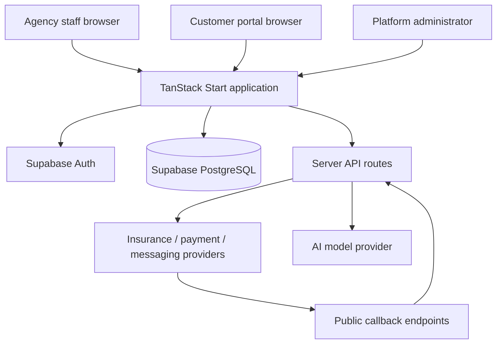

# System architecture (logical, not infrastructure-verified)

**Trust boundary:** Every browser request and public callback must be authorized and validated server-side. Tenant isolation and deployed infrastructure remain unverified.
